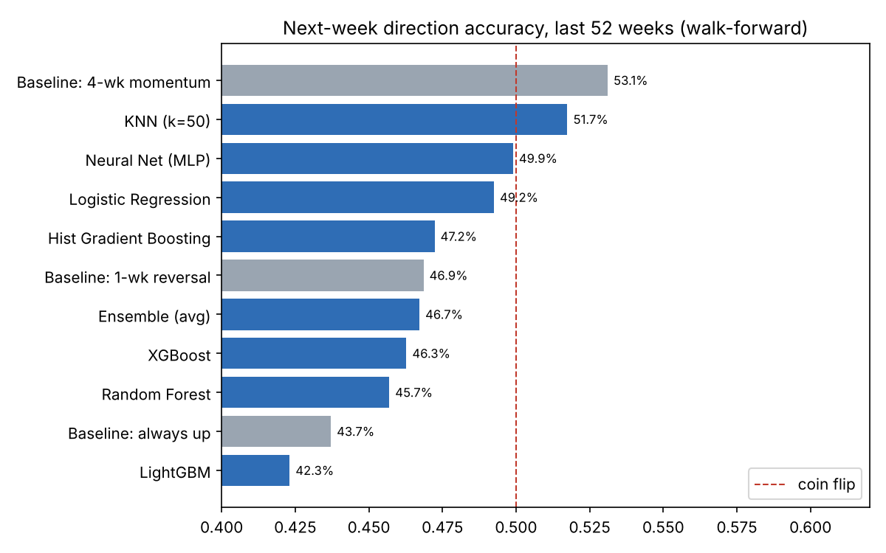
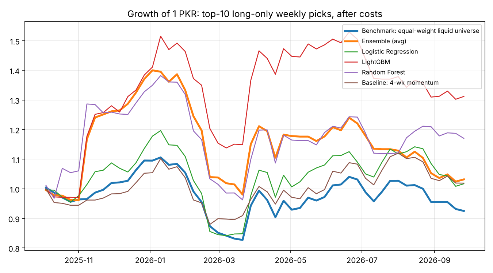

# PSX: can we predict next week's direction?

**Short answer: not reliably.** Over the last 52 weeks of PSX data (Oct 2025 – Oct 2026),
none of the 7 machine-learning models predicted "up or down next week" significantly
better than a coin flip for liquid KSE-100 stocks. The rerun on the previous year
(Oct 2024 – Oct 2025) gave the same answer, and the model ranking changed completely
between the two years. That pattern points to luck, not skill.

Script: [`scripts/psx_weekly_direction_backtest.py`](../../scripts/psx_weekly_direction_backtest.py)

## Data

- Daily open/high/low/close/volume for 105 KSE-100 constituents, Oct 2016 → **8 Oct 2026**,
  scraped from the PSX Data Portal (dps.psx.com.pk) and published by Muhammad Wasif
  ([GitHub, MIT licence](https://github.com/Muhammad-Wasif/PSX-Stock-Market-Dataset)).
  The PSX site itself was blocked from the machine that ran this analysis, so this mirror was used.
  Snapshot: `data/raw/psx/`.
- Prices are **not adjusted** for dividends, bonus shares or splits. Any day with a move
  above 11% (PSX's circuit breaker is ~10%) is treated as a corporate action, and the
  affected weeks are dropped.
- **Significant volume filter** (point in time, no look-ahead): median daily traded value
  ≥ **PKR 50M** over the previous 60 sessions, and trading on ≥ 90% of those days.
  That leaves about 56 stocks a week in the test year.

## Setup

| | |
|---|---|
| Prediction | Will this week's last close be beaten by next week's last close? (up = 1) |
| Samples | One per stock per week. Weeks don't overlap, so the scores aren't inflated |
| Features (31) | 1–120 day returns, volatility, distance from 20/50/200-day averages, RSI, MACD, 52-week-high distance, volume surges (5d/60d, 1d/20d), traded value, market return and breadth, returns relative to the market, cross-sectional ranks |
| Training | 2018 onward, expanding window, refit every 4 weeks, 1-week gap before each test block |
| Models | Logistic Regression, KNN, Random Forest, Hist Gradient Boosting, LightGBM, XGBoost, Neural Net (MLP), plus an average of all 7 |
| Baselines | Always up · 4-week momentum (up if the last 20 days were up) · 1-week reversal |
| Trading sim | Each week buy the 10 stocks with the highest probability of rising (only if > 50%), equal weight, hold one week, 0.15% cost per side. Long-only |

## Results: last year (weeks of 10 Oct 2025 → 2 Oct 2026, 2,926 predictions)

Only 43.7% of stock-weeks went up, so this was a falling market.

| Model | Accuracy | AUC | Stock-picking AUC within each week | p (accuracy > 50%) |
|---|---|---|---|---|
| Baseline: 4-wk momentum | **53.1%** | 0.530 | 0.514 | 0.12 |
| KNN | 51.7% | 0.500 | 0.516 | 0.22 |
| Neural Net | 49.9% | 0.509 | 0.507 | 0.52 |
| Logistic Regression | 49.2% | 0.479 | **0.533** | 0.61 |
| Hist Gradient Boosting | 47.2% | 0.422 | 0.506 | 0.80 |
| Ensemble (avg) | 46.7% | 0.427 | 0.517 | 0.88 |
| XGBoost | 46.3% | 0.432 | 0.529 | 0.89 |
| Random Forest | 45.7% | 0.409 | 0.517 | 0.89 |
| Baseline: always up | 43.7% | 0.500 | – | 0.93 |
| LightGBM | 42.3% | 0.385 | 0.509 | 0.99 |

The p-values come from a t-test on the 52 weekly accuracies. Testing week by week matters,
because stocks move together: in some weeks 0% of stocks rose, in others 98%.

**Trading simulation (after costs):** LightGBM +31%, Random Forest +17%, Ensemble +3%,
benchmark (equal-weight liquid stocks) −7.5%.

## Robustness check: the previous year (Oct 2024 → Oct 2025)

Run with `--test-end 2025-10-08`; outputs are in `test_end_2025-10-08/`. That was a strong
bull market (55% of stock-weeks went up; the benchmark gained +96%).

- Best accuracy: **"always up" at 55.0%**. Best model: LightGBM at 52.3% (p = 0.19).
- No model's stock-picking AUC within a week was above 0.51.
- Trading: Ensemble +98% against the benchmark's +96%. LightGBM, last year's winner,
  made +65%: it lagged the benchmark by 31 points.

## What this means

1. **Weekly direction is mostly driven by the whole market.** In the final fit, the
   LightGBM model relied most on market-wide features (market return, breadth). Those
   features fit the 2018–2025 data but failed in 2025–26: the models' average predicted
   probability was *negatively* correlated with the share of stocks that actually rose.
2. **Picking stocks within a week shows at most a faint signal.** Logistic Regression scored
   0.533 last year (p = 0.06) and XGBoost 0.529 (p = 0.04). Neither held up the year
   before, and with this many models tested, one p ≈ 0.04 is expected by chance.
3. **The +31% LightGBM result is not evidence of an edge.** It came from a few good weeks,
   with a −25% drawdown, and the same model trailed the market by 31 points the year before.
4. The simple 4-week momentum rule was the most consistent: about 53% in both years and the
   lowest volatility. It still isn't statistically significant.

## Next-week predictions (from 8 Oct 2026 data)

`data/processed/psx/next_week_predictions.csv` holds each model's probability for the 48 liquid
stocks. The ensemble's top picks were SAZEW, PRL, OGDC, CNERGY and POL, at about 56–57%.
Given the backtest above, treat these as close to a coin flip. The data ends 8 Oct 2026, so
these numbers are about four weeks out of date as of 3 Nov 2026. Rerun the script on fresh
data before using them.

## Ideas that might do better

- Predict **"beats the market next week"** instead of up/down. This removes the market-wide
  noise that dominates the current label.
- Add data price alone doesn't capture: foreign/local flows (NCCPL FIPI/LIPI), the SBP
  policy-rate calendar, results and dividend dates, PKR/USD and oil.
- Test over several years and different market conditions, and apply a correction for
  testing many models before trusting any single winner.

*Educational analysis, not investment advice.*
